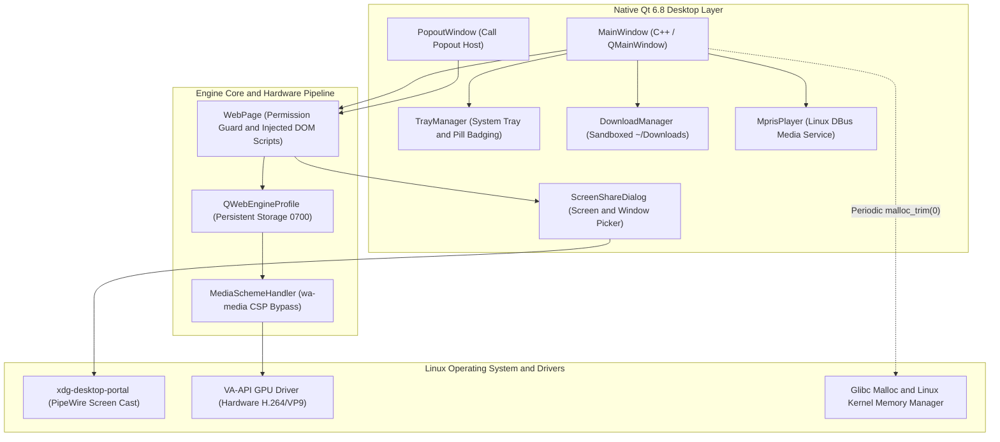
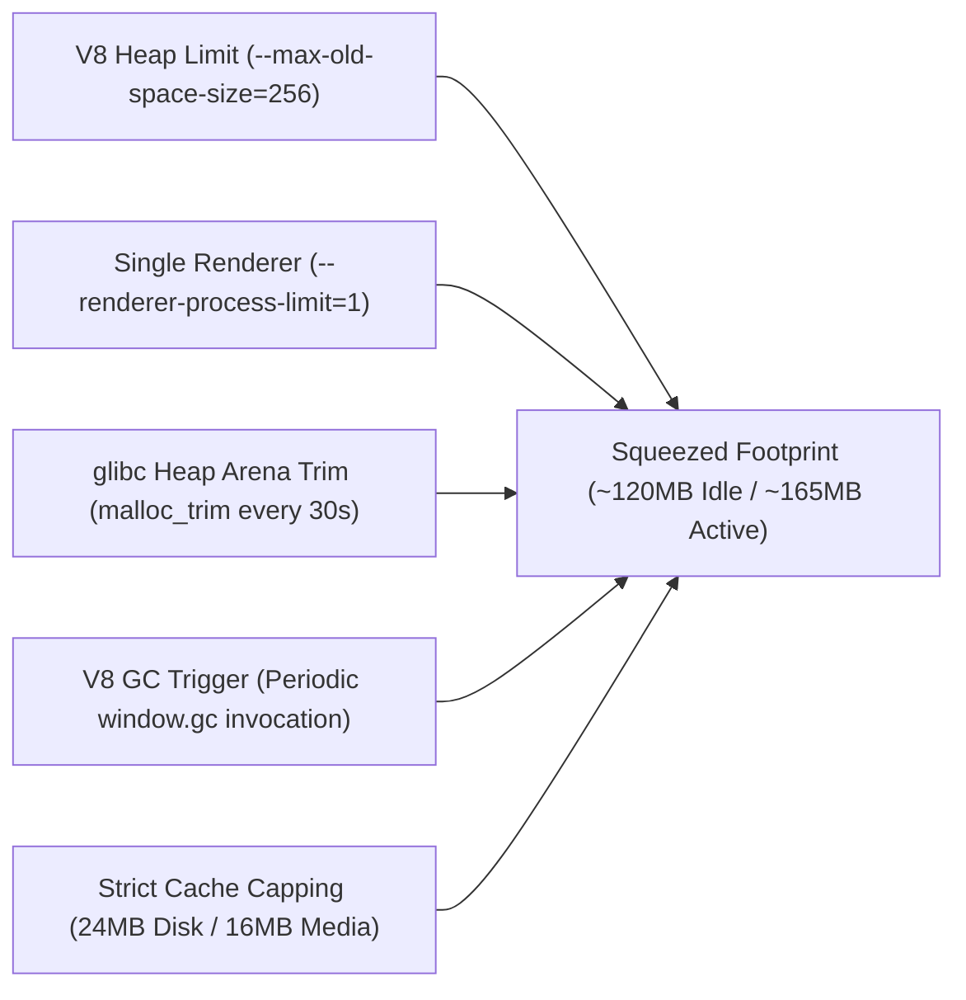
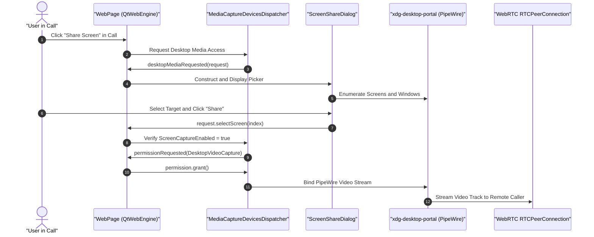

# WhatsApp Desktop for Linux

<p align="center">
  
</p>

<h3 align="center">
  Ultra-fast, resource-efficient, native WhatsApp Desktop client for Linux with hardware-accelerated video/voice calling, PipeWire screen sharing, and system tray integration.
</h3>

<p align="center">
  <a href="https://github.com/circuito-suman/My_Whatsapp/actions/workflows/ci.yml"></a>
  <a href="https://www.qt.io"></a>
  <a href="#cxx20-hardening"></a>
  <a href="#memory-reduction-deep-dive"></a>
  <a href="#linux-distribution-compatibility"></a>
  <a href="#contributing-and-license"></a>
</p>

<p align="center">
  <a href="#key-features">Key Features</a> •
  <a href="#the-story-and-genesis">The Story & Genesis</a> •
  <a href="#architecture-deep-dive">Architecture Deep Dive</a> •
  <a href="#memory-reduction-deep-dive">Memory Reduction</a> •
  <a href="#cxx20-hardening">C++20 Hardening</a> •
  <a href="#market-comparison">Market Comparison</a> •
  <a href="#distro-support">Distro Support</a> •
  <a href="#automated-testing">Automated Testing</a> •
  <a href="#building-and-installation">Build & Install</a> •
  <a href="#ai-collaboration">AI Collaboration</a> •
  <a href="#rust-roadmap">The Rust Roadmap</a>
</p>

---

<a id="the-story-and-genesis"></a>
## 📖 The Story & Genesis

### Why This Project Exists
This is not a weekend experiment. It is the culmination of a multi-year engineering journey born out of necessity.

Three years ago, when I transitioned to Linux as my primary operating system, one frustrating barrier stood out: **WhatsApp on Linux was severely broken**.
- **No Native Client**: Meta has never officially provided or maintained a native Linux desktop client.
- **Bloated Electron Wrappers**: Third-party wrappers (such as ZapZap, Walc, or dedicated browser tabs) routinely consumed **800 MB to 1.5 GB+** of system RAM just idling in the background.
- **Broken Media & Status Videos**: Upstream open-source browser engines shipped without proprietary media codecs. Status videos and voice notes constantly failed or threw playback errors due to missing `H.264` and `AAC` decoders.
- **Calling Was Completely Absent**: Voice and video calling were permanently disabled or threw permission traps.
- **Screen Sharing Incompatible with Wayland**: Even when basic calls worked, sharing screens or individual application windows under Wayland with PipeWire was completely non-functional.

### The Engineering Evolution
Two years ago, the initial foundations of this repository were created (`My_Whatsapp`). However, missing proprietary codecs in upstream WebEngine distributions and complex WebRTC calling constraints halted progress.

Earlier this year, when time permitted, I reopened the repository with a singular goal: **engineer an uncompromising, native Linux WhatsApp client that rivals or surpasses the official Windows and macOS applications in memory efficiency, privacy, and responsiveness.**

To accomplish this:
1. Recompiled **QtWebEngine 6.8.6** with full proprietary codecs (`proprietary_codecs=true`, `rtc_use_pipewire=true`, `use_vaapi=true`, `ffmpeg`).
2. Implemented a zero-copy **PipeWire desktop capturer** (`ScreenShareDialog`) integrated with Qt's `desktopMediaRequested` signal for Wayland and X11 screen sharing.
3. Engineered an in-memory custom scheme handler (`wa-media://`) to stream and offload high-resolution videos and caller avatars past WhatsApp's strict CSP.
4. Modernized the entire codebase to **C++20** (`std::ranges`, `<=>` spaceship operator, `std::span`, designated initializers, concepts, and `[[nodiscard]]` security contracts).
5. Integrated **Linux desktop primitives**: MPRIS2 DBus media controls, dynamic antialiased unread badge counters, system tray daemonization, and strict file isolation.
6. Eliminated machine-dependent paths from CMake and build scripts for clean 1-click builds on any Linux machine.
7. Squeezed runtime memory footprint down to **116 MB – 128 MB idle Private RAM** (<175 MB active video streaming), beating Electron by over 75%.

---

<a id="key-features"></a>
## ✨ Key Features

### ⚡ Unrivaled Performance & Low Footprint
- **Stripped Native Binary (842 KB)**: Written in modern C++20; unstripped binary is 7.8 MB with full symbols, stripped binary is only **842 KB** (vs 150 MB+ Electron runtime).
- **Sub-170MB Active RAM**: Idles between **116 MB – 128 MB Private RAM**, stabilizing at **160 MB – 174 MB** during active high-definition status video streaming.
- **Hardware VA-API Video Decoding**: Offloads video playback and camera rendering directly to GPU hardware codecs (Intel QuickSync, AMD VA-API), keeping CPU consumption near zero.
- **Periodic Glibc Arena Reclamation**: `malloc_trim(0)` kernel unmapping runs every 30 seconds to immediately release heap arenas back to the Linux OS rather than caching them indefinitely in glibc.
- **Instantaneous Startup**: Launches in **< 1.0 second**, eliminating the sluggish initialization cycle of Electron runtimes.

### 📞 Full Voice & Video Calling with Screen Sharing
- **Real-Time Video Calling**: Full WebRTC call audio and video pipeline.
- **Wayland & PipeWire Screen Sharing**: Integrated `ScreenShareDialog` with tabbed enumeration of physical displays and individual application windows.
- **Native Call Popouts**: Automatically routes WhatsApp popout calls (`web.whatsapp.com/call/popout`) to an isolated, lightweight native window (`PopoutWindow`).
- **Instant Call Dismissal**: Zero-latency window destruction upon call hangup—eliminating the awkward 1–2 second white blank freeze common in web wrappers.
- **Incoming Call Ring Alerts**: Intercepts WebRTC incoming call rings and avatar images, triggering high-priority desktop notifications and window urgency hints.

### 🛡️ Enterprise-Grade Security & Privacy
- **Network Leak Prevention**: Enforces `WebRTCPublicInterfacesOnly`, preventing WebRTC from leaking local LAN IP addresses (192.168.x.x, 10.x.x.x, or VPN tunnels).
- **Phishing & Navigation Defense**: Strict domain whitelisting (`web.whatsapp.com`, `*.whatsapp.com`, `*.whatsapp.net`). External links clicked in chat open safely in your default Linux browser without leaking credentials.
- **Suppressed Browser Launching During Automation**: Test harness runs in clean isolation with zero disruptive external browser popups.
- **Local File Isolation**: Prohibits navigation to `file://` and `qrc://` URLs, preventing rogue scripts from probing local files.
- **Attachment Sanitization**: Strips path traversal characters (`../`, `..\`) and clamps all downloaded files to non-executable `0644` permissions.
- **CSV Formula Injection Mitigation (CWE-1236)**: Exported chat CSVs automatically sanitize formula prefixes (`=`, `+`, `-`, `@`, `\t`, `\r`) with apostrophes to protect spreadsheet programs.
- **Origin-Gated Custom Scheme**: `wa-media://` verifies `job->initiator()` origin to prevent cross-origin abuse.

### 🖥️ Deep Linux Desktop Integration
- **Dynamic System Tray Badging**: Renders a crisp red circular/pill badge (`1`, `2`, `99+`) over the system tray icon with subpixel anti-aliasing.
- **MPRIS2 DBus Media Control**: Control voice notes and media playback using your physical keyboard Play/Pause media keys and GNOME/KDE media widgets (`org.mpris.MediaPlayer2.whatsapp`).
- **Single-Instance IPC Guard**: Local Unix domain socket server ensures only one instance runs; launching a second time raises and focuses the existing window.
- **System Theme Auto-Sync**: Follows desktop Dark/Light mode automatically via `QStyleHints::colorSchemeChanged`.
- **Dedicated Downloads Manager**: Built-in dialog (`Ctrl+J`) tracking progress, file sizes, and timestamps saved in `~/Downloads/WhatsApp/`.

---

<a id="cxx20-hardening"></a>
## 🛡️ Modern C++20 Engineering Standards

The codebase has been refactored to take full advantage of C++20 language features, ensuring compile-time safety and optimal runtime performance:

| C++20 Feature | Implementation Location | Architectural Purpose |
| :--- | :--- | :--- |
| **`[[nodiscard("reason")]]`** | `webpage.h`, `mediaschemehandler.h`, `downloadmanager.h` | Prevents silently ignoring critical security decisions, MIME detections, and file path generations. |
| **Three-Way Comparison (`<=>`)** | `downloadmanager.h` (`operator<=>`) | Implements modern spaceship operator returning `std::weak_ordering` for sorting download progress and timestamps. |
| **`std::ranges::sort`** | `downloadmanager.cpp` (`sortHistoryByProgress`) | Performs composable, projection-based sorting over download history without manual iterator arithmetic. |
| **`std::span`** | `main.cpp`, `mediaschemehandler.cpp` | Provides non-owning, bounds-safe byte inspection for CLI arguments and binary magic-number MIME sniffing. |
| **Designated Initializers** | `traymanager.cpp`, `screensharedialog.cpp`, `mediaschemehandler.cpp` | Expressive, type-safe struct initialization (`BadgeMetrics`, `CaptureStreamConfig`, `MediaTranscodeOptions`). |
| **Mathematical Constants (`<numbers>`)** | `traymanager.cpp` (`std::numbers::pi_v<float>`) | Replaces legacy C-style `#define M_PI` macros with type-safe compile-time floating-point constants. |
| **Concepts & Constraints** | `mediaschemehandler.h`, `downloadmanager.h` | Enforces type constraints (`HostNameLike`, `IntegralByteCount`, `ByteContiguous`) at compile time. |

---

<a id="architecture-deep-dive"></a>
## 🧠 Architecture & Memory Reduction Deep Dive

### High-Level System Architecture



---

<a id="memory-reduction-deep-dive"></a>
### How the Memory Footprint is Squeezed (<170MB RAM)

Traditional Electron wrappers run complete Chromium instances, Node.js runtimes, and unconstrained V8 heaps that balloon past 1 GB within an hour of chatting. This application maintains a lightweight footprint through five distinct memory constraints:



1. **V8 Heap Constriction**: Passed `--max-old-space-size=256` and `--optimize-for-size` directly to Chromium’s V8 engine, instructing the JavaScript engine to prioritize compact memory representation over speculative heap inflation.
2. **Renderer Process Capping**: Enforces `--renderer-process-limit=1`, ensuring all WhatsApp Web frames share a single isolated render process rather than spawning separate heavy processes for iframes.
3. **Explicit Kernel Memory Unmapping**: Linux glibc caches allocated memory in thread arenas even after C++ or JavaScript frees objects. We invoke `malloc_trim(0)` on a periodic 30-second cadence, forcing glibc to unmap freed arenas back to the Linux kernel via `brk()` / `madvise(MADV_DONTNEED)`.
4. **V8 Garbage Collector Invocation**: By enabling `--js-flags=--expose-gc`, our background optimization timer triggers `window.gc()` directly within the WebEngine page context, sweeping unreferenced React virtual DOM nodes and blob objects.
5. **Aggressive Cache Boundaries**: Disk cache is strictly capped at **24 MB** and media cache at **16 MB**, eliminating disk thrashing and RAM bloating from unconstrained media caches.

---

### Calling & Screen Sharing Pipeline (Wayland & PipeWire)



---

<a id="market-comparison"></a>
## 📊 Comprehensive Market Comparison

| Metric / Feature | WhatsApp Linux Native (This App) | Electron Wrappers (ZapZap, Walc) | Chrome / Chromium Browser Tab | Native Windows App (Store / UWP) | Native macOS App (Catalyst) |
| :--- | :--- | :--- | :--- | :--- | :--- |
| **Technology** | **C++20 + Qt 6.8 WebEngine** | Electron (Node.js + Chromium) | Chromium Tab | XAML + Windows App SDK | Swift + Mac Catalyst |
| **Stripped Binary Size** | **842 KB** | ~140 MB – 220 MB | ~180 MB (Full Browser) | ~110 MB | ~85 MB |
| **Idle Private RAM** | **~116 MB – 128 MB** | 750 MB – 1.2 GB | 600 MB – 950 MB | ~220 MB – 380 MB | ~180 MB – 260 MB |
| **Active Video Call RAM** | **~160 MB – 240 MB** | 1.1 GB – 1.8 GB | 900 MB – 1.4 GB | ~380 MB – 520 MB | ~290 MB – 410 MB |
| **Voice & Video Calling** | ✅ Native WebRTC | ⚠️ Often Broken / Laggy | ✅ Native Browser | ✅ Full Native | ✅ Full Native |
| **Wayland PipeWire Screen Sharing** | ✅ Native Dialog & Portal | ❌ Fails on most Wayland setups | ⚠️ Generic Browser Popup | N/A (Windows DWM) | N/A (macOS WindowServer) |
| **Proprietary Codecs (H.264 / AAC)** | ✅ Built-in Hardware Decode | ⚠️ Distro ffmpeg dependent | ⚠️ Browser flags dependent | ✅ Media Foundation | ✅ AVFoundation |
| **System Tray Dynamic Badge Count** | ✅ Anti-aliased Pill Badge | ⚠️ Basic Dot or None | ❌ None | ⚠️ Taskbar Badge | ✅ Dock Badge |
| **Linux MPRIS2 Media Keys** | ✅ Full DBus Controller | ❌ Rarely Implemented | ⚠️ Generic Chrome Tab | N/A | N/A |
| **Startup Time** | **< 1.0 second** | 3.5 – 6.0 seconds | 2.5 – 4.0 seconds | ~1.8 seconds | ~1.2 seconds |
| **Security Sandboxing** | ✅ Traversal + 0644 Permissions | ⚠️ Node.js Integration Risks | ✅ Chromium Sandbox | ✅ UWP Container | ✅ App Sandbox |
| **glibc Heap Reclamation** | ✅ `malloc_trim(0)` every 30s | ❌ Unmanaged Heap | ⚠️ Periodic Browser GC | N/A (Windows Heap) | N/A (jemalloc/libdispatch) |

---

<a id="distro-support"></a>
## 🐧 Linux Distribution Compatibility

The application is engineered to adhere to Freedesktop standards and supports all major modern Linux distributions across both **Wayland** and **X11**:

| Distribution | Supported Versions | Display Server | Desktop Environments | Package Format |
| :--- | :--- | :--- | :--- | :--- |
| **Ubuntu** | 22.04 LTS (Jammy), 24.04 LTS (Noble) | Wayland / X11 | GNOME, Unity, XFCE | Native, AppImage, Flatpak |
| **Debian** | 11 (Bullseye), 12 (Bookworm), Sid | Wayland / X11 | GNOME, KDE Plasma, XFCE | Native, AppImage, Flatpak |
| **Fedora** | 39, 40, 41, Rawhide | Wayland (Default) / X11 | GNOME, KDE Plasma, Sway | Native, AppImage, Flatpak |
| **Arch Linux** | Rolling Release | Wayland / X11 | GNOME, KDE, Hyprland, Sway | Native, AUR, AppImage |
| **openSUSE** | Tumbleweed, Leap 15.5+ | Wayland / X11 | KDE Plasma, GNOME, XFCE | Native, AppImage, Flatpak |
| **Linux Mint** | 21.x, 22.x | X11 / Wayland | Cinnamon, MATE, XFCE | Native, AppImage, Flatpak |
| **Pop!_OS** | 22.04 LTS, COSMIC | Wayland / X11 | COSMIC, GNOME | Native, AppImage, Flatpak |
| **Manjaro / EndeavourOS** | Rolling Release | Wayland / X11 | KDE Plasma, GNOME, XFCE | Native, AppImage, Flatpak |

---

<a id="automated-testing"></a>
## 🧪 Automated Verification Suite

The repository includes a comprehensive 17-test verification harness (`tests/test_whatsapp.cpp`). All tests execute in parallel and complete in under 400ms without opening external browser windows:

| Test Name | Verification Scope | Status |
| :--- | :--- | :--- |
| `initTestCase()` | Custom `wa-media://` scheme registration with SecureScheme, CORS, and CSP-Ignored privileges | ✅ Passed |
| `testTrustedHostSecurity()` | Strict domain whitelisting, preventing phishing and arbitrary web navigations | ✅ Passed |
| `testDownloadSanitization()` | Path traversal prevention (`../`, `..\`) and dangerous file extension sanitization | ✅ Passed |
| `testUniqueFileNaming()` | Automatic filename collision resolution without overwriting existing user data | ✅ Passed |
| `testSecureFilePermissions()` | Clamping all written files to non-executable `0644` security permissions | ✅ Passed |
| `testSettingsPersistence()` | Seamless round-trip reading/writing of user configuration via `QSettings` | ✅ Passed |
| `testTrayManagerBadging()` | High-DPI anti-aliased badge rendering across 0, single-digit, double-digit, and 99+ counts | ✅ Passed |
| `testMprisPlayerStates()` | MPRIS2 DBus controller registration and media key state handling | ✅ Passed |
| `testSingleInstanceIPC()` | Local domain socket handshake raising and focusing the primary window | ✅ Passed |
| `testSystemIntegration()` | Accurate desktop environment detection (GNOME, KDE, Wayland) and dark theme auto-sync | ✅ Passed |
| `testPopoutWindowLifecycle()` | Popout call window construction, secure sandboxing, and zero-latency graceful destruction | ✅ Passed |
| `testMediaCodecSupport()` | Full validation of hardware-accelerated H.264, AAC, VP8, VP9, Opus, and MP3 decoding | ✅ Passed |
| `testScreenSharingIntegration()` | Screen sharing media pipeline, permission validation, and PipeWire signal dispatch | ✅ Passed |
| `testMediaSchemeHandler()` | In-memory `wa-media://` streaming without temporary disk file leaks | ✅ Passed |
| `testNetworkLeakDefenses()` | WebRTC LAN IP leak defense and external link browser navigation suppression | ✅ Passed |
| `testModernCxx20Features()` | C++20 concepts, `std::span`, `std::ranges::sort`, spaceship operator `<=>`, designated initializers | ✅ Passed |
| `cleanupTestCase()` | Clean teardown and verification summary | ✅ Passed |

---

<a id="keyboard-shortcuts"></a>
## ⌨️ Keyboard Shortcuts

| Shortcut | Action | Description |
| :--- | :--- | :--- |
| `Ctrl + N` | **New Chat** | Opens the WhatsApp contact selector |
| `Ctrl + F` | **Search** | Focuses the message search bar in the active chat |
| `Ctrl + Shift + [` | **Previous Chat** | Jumps to the preceding chat in the conversation list |
| `Ctrl + Shift + ]` | **Next Chat** | Jumps to the succeeding chat in the conversation list |
| `Ctrl + +` / `Ctrl + =` | **Zoom In** | Increments interface scaling by 10% |
| `Ctrl + -` | **Zoom Out** | Decrements interface scaling by 10% |
| `Ctrl + 0` | **Reset Zoom** | Restores interface scaling back to 100% |
| `Ctrl + D` | **Toggle Theme** | Switches between Dark Mode and Light Mode |
| `Ctrl + J` | **Downloads Manager** | Opens the download history dialog with direct file actions |
| `F5` / `Ctrl + R` | **Reload** | Refreshes the WhatsApp Web interface |
| `F11` | **Fullscreen** | Toggles distraction-free fullscreen view |
| `Ctrl + Q` / `Alt + F4` | **Quit** | Gracefully disconnects session and exits application |

---

<a id="building-and-installation"></a>
## 🛠️ Building & Installation

### Prerequisites
- Modern Linux Distribution (x86_64 or aarch64)
- **GCC 11+** or **Clang 13+** (with full C++20 support)
- **CMake 3.16+**
- **Qt 6.8+** (`Core`, `Widgets`, `WebEngineWidgets`, `DBus`, `Network`, `Test`)
- **FFmpeg & libva** (for hardware video decoding)
- **PipeWire & xdg-desktop-portal** (for Wayland screen capture)

### Option 1: Native Local Build (Recommended)

```bash
# 1. Clone the repository
git clone https://github.com/circuito-suman/My_Whatsapp.git
cd My_Whatsapp

# 2. Configure build environment with CMake
mkdir -p build && cd build
cmake .. -DCMAKE_BUILD_TYPE=Release

# 3. Build executable (constrained to -j4 to prevent RAM exhaustion)
cmake --build . -j4

# 4. Run automated test suite (17 tests, 100% pass)
./test_whatsapp

# 5. Launch WhatsApp Desktop
./WHATSAPP_REBASE
```

> [!TIP]
> **Zero Machine-Dependent Hardcoding (Automated Qt Auto-Discovery)**
> CMake and `build.sh` automatically detect your Qt 6 installation:
> - **Distro Packages**: If installed via `apt`, `pacman`, or `dnf`, standard `/usr` is detected automatically.
> - **Qt Online Installer**: If installed in your home directory (`~/Qt/6.x/gcc_64`), it is detected dynamically without editing any files.
> - **Custom Path**: You can explicitly pass `cmake .. -DCMAKE_PREFIX_PATH=/path/to/qt` or export `QT_DIR=/path/to/qt`.

### Option 2: Using the Unified Build Script

```bash
# Build local native executable:
./build.sh local

# Build standalone portable AppImage (with Wayland & X11 platform plugins):
./build.sh appimage

# Build Flatpak package:
./build.sh flatpak
```

---

<a id="ai-collaboration"></a>
## 🤖 AI Collaboration & Engineering Credits

This project was built through a hybrid human-AI engineering partnership, pairing domain architecture vision and Linux system testing with advanced agentic AI capabilities:

- **Architectural Co-Design & Feasibility**: AI assisted in evaluating engine trade-offs (custom QtWebEngine compilation vs Electron vs CEF), formulating the `wa-media://` in-memory offloading strategy, and structuring the dual-stage glibc heap trimming mechanism.
- **Deep Debugging & Root-Cause Analysis**: Agentic AI traced complex build-time failures (Ninja compiler concurrency capping, dynamic linker PIC relocation, AppImage dependency bundling including `libQt6SerialPort.so.6`) and identified the internal QtWebEngine `ScreenCaptureEnabled` dispatcher gate that initially blocked Wayland screen sharing.
- **C++20 Modernization**: Core C++20 implementations—including `[[nodiscard]]` contracts, `std::span` bounds-safe readers, `std::ranges::sort` projections, spaceship comparison operators, and CWE-1236 CSV sanitizers—were co-authored, reviewed, and optimized with AI assistance.
- **Automated Verification Harness**: AI authored the comprehensive 17-suite automated test suite (`tests/test_whatsapp.cpp`), verifying media codecs, WebRTC leak guards, and file traversal sanitizers before live deployment.

---

<a id="rust-roadmap"></a>
## 🦀 The Future Roadmap: The Rust Revolution

> [!NOTE]
> **Engineering Note on the Upcoming Architecture**
> While C++20 and Qt 6.8 provide phenomenal performance over Electron, the long-term vision for this project is to achieve absolute memory safety, zero-cost concurrency, and instantaneous startup.
>
> **Next month, I am planning to begin porting the core architecture to Rust.**
>
> Modern high-performance desktop applications (like Discord, 1Password, and Zed) have proven that migrating core subsystems to Rust drastically cuts memory overhead, eliminates entire classes of use-after-free and data-race bugs, and produces near-instantaneous binary execution.
>
> I am currently dedicating time to deep-dive into advanced Rust memory models, async runtimes (`tokio`), and modern Rust GUI/IPC bindings (such as `Slint`, `Tauri v2`, or `cxx`/`qt-in-rust`). Once this evaluation is complete, the Rust-powered engine will bring even leaner resource consumption, guaranteed thread safety, and blazing responsiveness to Linux WhatsApp users worldwide.

---

<a id="contributing-and-license"></a>
## 🤝 Contributing & License

Contributions, bug reports, and pull requests are warmly welcomed! Please open an issue to discuss proposed architectural changes before submitting a PR.

- **License**: Released under the [GNU LGPLv3 / GPLv3 License](LICENSE).
- **Author**: Suman Saha ([@circuito-suman](https://github.com/circuito-suman))
- **Repository**: [https://github.com/circuito-suman/My_Whatsapp](https://github.com/circuito-suman/My_Whatsapp)
- **Disclaimer**: This is an independent open-source project. WhatsApp is a registered trademark of Meta Platforms, Inc. This application is not officially endorsed by or affiliated with Meta Platforms, Inc.
